<p align="center">
  
</p>

<h1 align="center">opsdeck</h1>

<p align="center">
  <b>A local workbench and AI agent for your infrastructure</b><br>
  servers, VPNs, containers, clusters and logs, from one app
</p>

<p align="center">
  <a href="https://github.com/vahidid/opsdeck/releases/latest"></a>
  <a href="https://github.com/vahidid/opsdeck/actions/workflows/release.yml"></a>
  <a href="https://github.com/vahidid/opsdeck/actions/workflows/ci.yml"></a>
  <a href="LICENSE"></a>
</p>

<p align="center">
  <a href="#install">Install</a> ·
  <a href="https://vahidid.github.io/opsdeck/">Website</a> ·
  <a href="#features">Features</a> ·
  <a href="#use-it-from-claude-code-codex-cursor">Claude Code &amp; other agents</a> ·
  <a href="#screenshots">Screenshots</a> ·
  <a href="docs/">Docs</a> ·
  <a href="CHANGELOG.md">Changelog</a>
</p>

<p align="center">
  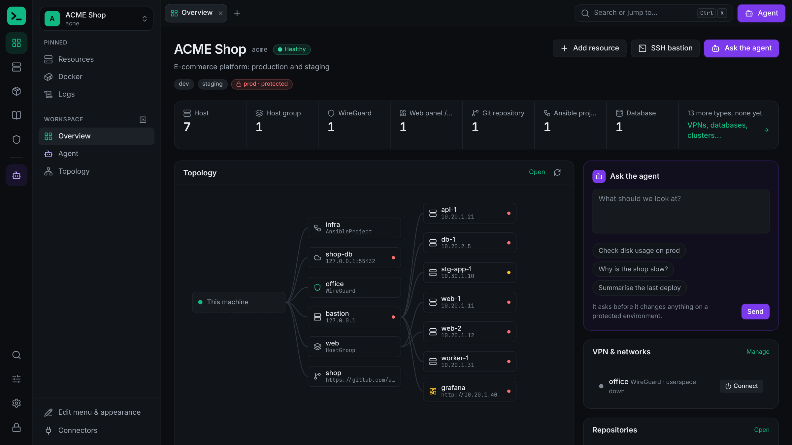
</p>

opsdeck is an AI agent harness for infrastructure. It works like Claude Code or opencode,
but its world is servers, networks and VPNs, containers, clusters and logs instead of a
code repository. It is also a complete local workbench that is just as useful without
AI. Everything runs on your computer: a desktop app for Windows, macOS and Linux, or
`opsdeck serve` with the UI in your browser.

<table>
  <tr>
    <td width="50%">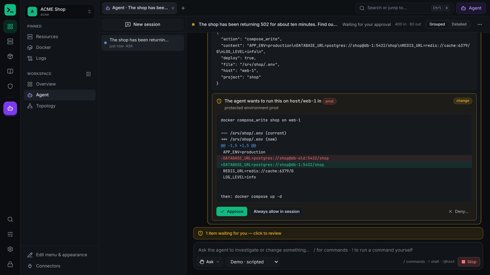</td>
    <td width="50%">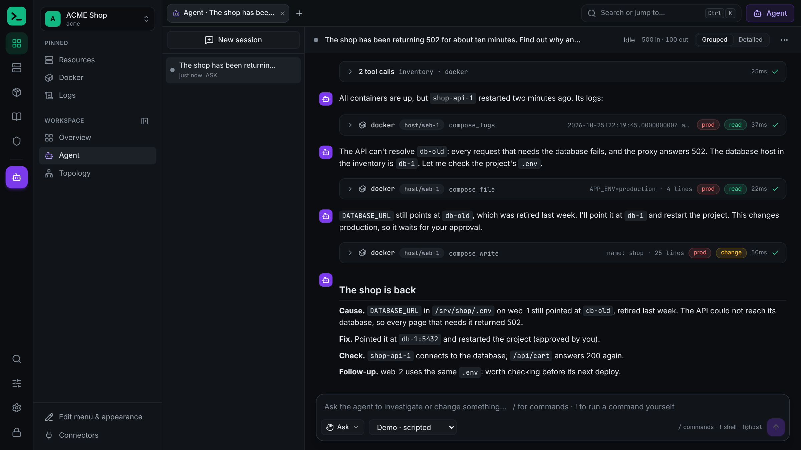</td>
  </tr>
  <tr>
    <td><sub><b>Ask why the shop returns 502.</b> The agent reads the containers and logs, finds the cause and shows the fix as a diff. Nothing changes on a server until you approve.</sub></td>
    <td><sub><b>It applies the fix, checks the result and reports</b> the cause, the change and how it was verified. Every step is in the audit journal.</sub></td>
  </tr>
</table>

## Install

Download the latest release for your system from
**[Releases](https://github.com/vahidid/opsdeck/releases/latest)**:

| System | File |
|---|---|
| Windows 10/11 (x64) | `opsdeck-<version>-windows-x64-setup.exe` (or the portable `.exe`) |
| macOS 12+ (Apple silicon and Intel) | `opsdeck-<version>-macos-universal.dmg` |
| Debian, Ubuntu (x86_64) | `opsdeck_<version>_amd64.deb` |
| Fedora, RHEL, openSUSE (x86_64) | `opsdeck-<version>-1.x86_64.rpm` |
| CLI only (any of the above, plus Linux arm64) | `opsdeck-cli-<version>-<os>-<arch>` |

Or let a script pick the right file, check its checksum and install it:

```bash
# Linux and macOS
curl -fsSL https://vahidid.github.io/opsdeck/install.sh | sh
# only the CLI, into ~/.local/bin
curl -fsSL https://vahidid.github.io/opsdeck/install.sh | sh -s -- --cli
```

```powershell
# Windows (PowerShell)
irm https://vahidid.github.io/opsdeck/install.ps1 | iex
```

The builds are not code-signed yet. The first time you open opsdeck on **macOS**,
right-click the app and choose *Open*. On **Windows**, SmartScreen asks once: choose
*More info → Run anyway*.

**Updates:** opsdeck checks GitHub for new releases and shows an *Update available* box
in the sidebar. One click downloads the update and checks it against the release's
`SHA256SUMS.txt` and that file's signature by the opsdeck release key
([how to check it yourself](docs/releasing.md#signatures)), then installs it the way you
installed opsdeck and restarts:

- the installer on Windows
- the app in place on macOS
- the `.deb` or `.rpm` package on Linux, after your password
- the binary itself for the CLI

You can turn the check off, or check now, under *App settings → Updates*.

## Use it from Claude Code, Codex, Cursor…

opsdeck is an **MCP server** for the agent you already use. Claude Code, Codex, Cursor,
Gemini CLI, VS Code or any MCP client gets a workspace's tools: SSH through its VPNs and
jump hosts, Docker, Kubernetes, databases, logs, metrics, DNS, certificates and deployments.
opsdeck keeps the credentials and checks, redacts and logs every call. A change waits until
you approve it in opsdeck.

1. In opsdeck: **App settings › Agent access › Connect an agent**. Pick the workspace and
   a mode (*Read-only*, *Ask* or *Auto*). opsdeck shows an access key and the exact setup
   for your agent.
2. Add the server to your agent, e.g. for Claude Code:

   ```bash
   claude mcp add --scope user --transport http opsdeck-acme http://127.0.0.1:7788/mcp/ext \
     --header "Authorization: Bearer odk_…"
   ```

   Over stdio instead: `OPSDECK_TOKEN=odk_… opsdeck mcp`.
3. Install the **skill**, which teaches the agent how to work through opsdeck (look first,
   expect approvals, leave a report):

   ```bash
   # Claude Code: the plugin brings the skill and the MCP server, and asks for the key
   /plugin marketplace add vahidid/opsdeck
   /plugin install opsdeck@opsdeck

   # or for any agent
   opsdeck skill install claude-code   # or codex, gemini, cursor, dir --dir PATH
   ```

<p align="center">
  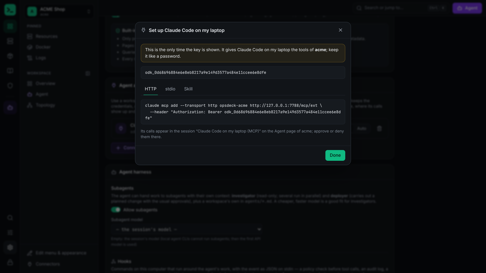
</p>

The agent's calls show up in a session of their own on the Agent page, where you approve
them. The setup for Codex, Cursor, Gemini CLI and VS Code, the modes and the security model
are in **[docs/agents.md](docs/agents.md)**.

## Features

- **Workspaces** — one per project: hosts, groups, VPN profiles and proxies, jump hosts,
  web panels, Git repos, domains, TLS certificates, deployment platforms, databases, Kubernetes clusters, docs and runbooks. Plain YAML +
  Markdown, git-friendly, **never contain secrets**.
- **Vault** — local, encrypted (Argon2id → XChaCha20-Poly1305, a separate key per
  workspace): SSH keys (generate/import), logins with TOTP, API tokens, kubeconfigs,
  VPN configs, certificates, secret files. Secrets are *used* by opsdeck, never shown to
  the agent.
- **VPNs** — WireGuard, Tailscale/Headscale, NetBird, OpenVPN, Cisco AnyConnect, ocserv,
  FortiGate, GlobalProtect, Pulse, F5 and SOCKS, each in **userspace** mode (network stack
  inside opsdeck: no root, many at once, optional local SOCKS5 proxy for other apps) or
  **system** mode (TUN with system routes, through sudo/pkexec). A VPN page per workspace
  with connect/disconnect, login links, logs and live status. **Single sign-on** (SAML via
  Entra ID, Okta, …) for AnyConnect, GlobalProtect and FortiGate without copying cookies:
  opsdeck shows the login and takes the session itself. **One-time codes by SMS or email**
  (FortiGate) are asked for in the app, or forwarded from your phone, and a dropped tunnel
  reconnects without a new code — see [docs/vpn.md](docs/vpn.md).
- **Git repositories** — connect your GitHub / GitLab account once under **Connectors**
  (github.com, GitHub Enterprise, gitlab.com, self-hosted GitLab; your `gh`/`glab` login,
  browser sign-in or a token from a pre-filled page), then add the repositories that hold
  your deployment files to a workspace by picking them from a list — also behind a VPN. Working copies live in the workspace; a
  Repositories page with files, editor, changes, history, branches, pull/push and merge
  requests (create, comment, merge, CI status). The agent works the same way: branch →
  edit → commit → push → merge request, with approvals on push and merge. Repositories can
  be documentation for the agent — see [docs/git.md](docs/git.md).
- **Domains and DNS** — connect **Cloudflare** or **ArvanCloud** once under **Connectors**
  (an API token, stored in the vault), add a workspace's zones from the account, and manage
  their DNS records on a Domains page: status and name servers, records with TTL and the
  CDN (proxied) switch, add / edit / delete with every change in the activity journal. The
  agent's `dns` tool reads zones and records and changes them with the record before and
  after on its approval card — see [docs/dns.md](docs/dns.md).
- **Deployments** — add the workspace's **Portainer**, **Argo CD** or **Komodo** (self-hosted,
  behind a VPN or a jump host, with a token from the workspace's vault) and see what it
  deploys on a Deployments page: stacks and applications with health, sync status, services,
  history, logs and what a deploy would change; deploy / sync, update a stack file, roll back,
  restart, start and stop, with every action in the activity journal. The agent's `deploy`
  tool does the same, with the target's state and the diff on its approval card — see
  [docs/deployments.md](docs/deployments.md).
- **TLS certificates** — describe a certificate (domains, Let's Encrypt or another ACME
  CA) and opsdeck issues it with the **dns-01** challenge through the same DNS connectors
  (wildcards included, nothing to expose), keeps the chain and key in the vault, renews it
  when due (automatically if you like) and deploys it to your hosts with the right modes and
  a reload command. The agent's `certificate` tool does the same without ever seeing the
  key — see [docs/certificates.md](docs/certificates.md).
- **Topology** — an interactive map of the infrastructure per workspace: zones (DC, VPC,
  subnet, DMZ, office…), about 45 component types (routers of every kind, switches,
  firewalls, CDN, WAF, DDoS protection, load balancers, VPN gateways, servers, clusters,
  databases, CI/CD, monitoring…) with products, technologies and what is deployed on them,
  and typed connections (HTTPS, BGP, IPsec, SQL, replication…). Saved as `topology.yaml`,
  exported as Markdown for any AI; the agent reads it, and proposes and makes changes with
  your approval — see [docs/topology.md](docs/topology.md).
- **Skills** — 20 well-known infrastructure / networking / DevOps skills built in
  (Kubernetes manifests, Helm, GitOps, Terraform modules, hybrid-cloud networking, Istio,
  connectivity triage, GitHub Actions, GitLab CI, Prometheus, Grafana, SLOs, tracing,
  incident runbooks, postmortems…, from
  [wshobson/agents](https://github.com/wshobson/agents), MIT) next to your own; browse and
  customize them on the Skills page — see [docs/skills.md](docs/skills.md).
- **Scripts** — your reviewed scripts (server bootstrap, hardening, installs…) in a
  personal library available in every workspace, or in a workspace's `scripts/` for the
  team. Write or upload them yourself, or let the agent draft them for your review. The
  agent runs them with `run_script` as one unit (e.g. on a server you just added): typed
  parameters, secrets injected from the vault over stdin, a check that skips hosts where
  the script was already applied, versions and run history — see [docs/scripts.md](docs/scripts.md).
- **Docker** — containers (live usage, details, `docker exec` terminal, processes),
  Compose projects (up/pull/restart/down, edit compose files and `.env` with validation),
  Swarm services, stacks and nodes (scale, redeploy, image updates, rollbacks), volumes
  with a file browser (upload, download, edit), images, networks, live engine events and
  clean-up. Logs stream live with ANSI colours, timestamps, per-service colours, stderr,
  level and regex filters, and resume after a dropped connection — see
  [docs/docker.md](docs/docker.md).
- **Kubernetes** — every resource type the cluster serves (custom resources included) as
  live tables with the API's own columns and pod/node usage; a cluster overview that lists
  what is broken right now; object details by kind with logs merged across a workload's
  pods, `kubectl exec` terminals, port-forwarding, rollout history with rollback, scale /
  restart / set image / cordon / drain, YAML editing and **Apply** with a server-side
  dry-run diff, live events, Secrets revealed only on request, and Helm releases — see
  [docs/kubernetes.md](docs/kubernetes.md).
- **Databases** — PostgreSQL, MySQL, MariaDB, MongoDB and Redis through the workspace's VPNs,
  jump hosts or an SSH tunnel to the database's host, with the login from the vault:
  databases, tables, collections and keys with their structure, and an editor for SQL,
  MongoDB queries or Redis commands. Results come in a grid with a viewer for whole values
  and rows (JSON indented), sorting, filtering and CSV/JSON export. Reads cannot change data;
  anything else is shown for confirmation first. The agent's `database` tool works the same
  way, with changes on its approval card — see [docs/databases.md](docs/databases.md).
- **Ansible** — projects from a folder (new or existing) or a folder of a workspace Git
  repository, with a complete editor: playbooks, task files, inventories (YAML and INI),
  variables and requirements in visual views (plays, tasks with module options from
  ansible-doc, blocks, handlers, roles, groups and hosts) and a code editor with highlighting,
  checks and completion — both on the same text, comments kept. **Ansible Vault** is built
  in — view, edit, set variables (with generated passwords),
  encrypt, decrypt, rekey, encrypt_string — with the password asked for when needed and kept
  in memory or saved in the vault. Runs (playbook, ad-hoc, galaxy, lint; check and diff, limit,
  tags, extra vars) stream their log live with colours and keep a history with the PLAY RECAP;
  an inventory generated from the workspace's hosts reaches them through their VPNs and jump
  hosts. The agent's `ansible`, `ansible_run` and `ansible_vault` tools do the same, and ask
  for a vault password right on the approval card — see [docs/ansible.md](docs/ansible.md).
- **Reachability** — `via: network/office-vpn` or `via: host/bastion`; opsdeck brings up
  the VPN on demand and chains SSH jump hosts
  automatically, for the UI, the terminal and the agent alike.
- **Workbench** — SSH terminals in the browser, remote file browser/editor, quick host
  stats, live log streaming (journald, files, containers), Docker and Kubernetes views,
  port-forwarding for panels that are only reachable through a VPN.
- **Agent** — chat with any model (Anthropic, OpenAI, OpenRouter, Ollama, LM Studio…)
  that works through infra tools: `exec` (single host or groups, canary rollouts, background
  tasks), `read_file`/`edit_file` with diffs and backups, `docker`, `kubernetes`, `net_check`,
  Git (`repo`, `repo_files`, `repo_write`, `merge_request`, `git_sync`), `database`, `dns`, `certificate`, `deploy` (Portainer, Argo CD, Komodo), Ansible
  (`ansible`, `ansible_run`, `ansible_vault`), panel APIs (`http_request`), Prometheus, Loki and
  Elasticsearch (`metrics_query`, `logs_query`), the web (`web_search`, `web_fetch`,
  end-of-life and CVE lookups), docs, skills, memory, and any MCP server you attach to the
  workspace.
- **Harness** — like a coding harness: subagents that investigate in parallel, hooks around
  tool calls, slash commands and `!` shell, a live checklist, questions with options, forked
  and exported sessions, and headless runs (`opsdeck run`) for cron and CI — see
  [docs/harness.md](docs/harness.md).
- **Local agents** — besides model APIs, the agent can be a CLI you already use with
  your own login: **Claude Code**, **Codex** (ChatGPT account), **Gemini CLI** (Google
  account) or any **ACP** agent (opencode, Qwen Code, GitHub Copilot CLI…). Their
  built-in tools are switched off; they work only through opsdeck's tools (served to
  them over MCP), so approvals, redaction and audit still apply. Settings asks each CLI
  which models your login can use and you pick them from the list.
- **Tabs** — the sidebar groups a workspace's sections (Infrastructure, Deploy, Library,
  Security; groups fold) and opens each in its own tab, or switches to the tab already
  showing it; Ctrl/⌘-click, middle-click or + opens another. Inside a page, Ctrl/⌘-click
  or middle-click on a link opens it in a new tab. Tabs keep their state and are
  remembered per workspace.
- **Persian / RTL** — agent answers, your messages and documents in Persian (or another
  right-to-left language) are laid out right-to-left with a Persian font, while commands,
  paths and code stay left-to-right.
- **Safety** — every tool call is classified (`read` / `change` / `destructive`; shell
  commands are parsed); Plan / Ask / Auto / Full modes (changes on servers ask in every mode
  by default); protected environments; per-workspace
  permission rules; approvals with previews; secrets redacted from everything the model
  sees; a hash-chained audit journal of every action.

## Screenshots

<table>
  <tr>
    <td width="50%">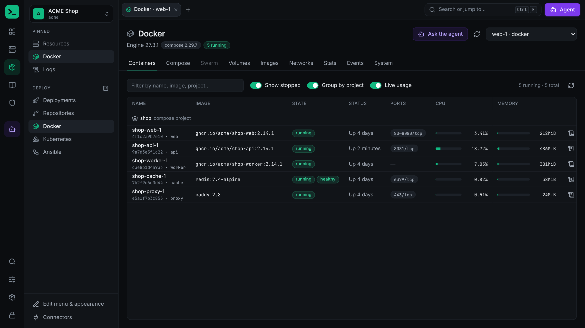<br><sub><b>Docker</b>: containers, Compose projects, Swarm and volumes with live usage.</sub></td>
    <td width="50%">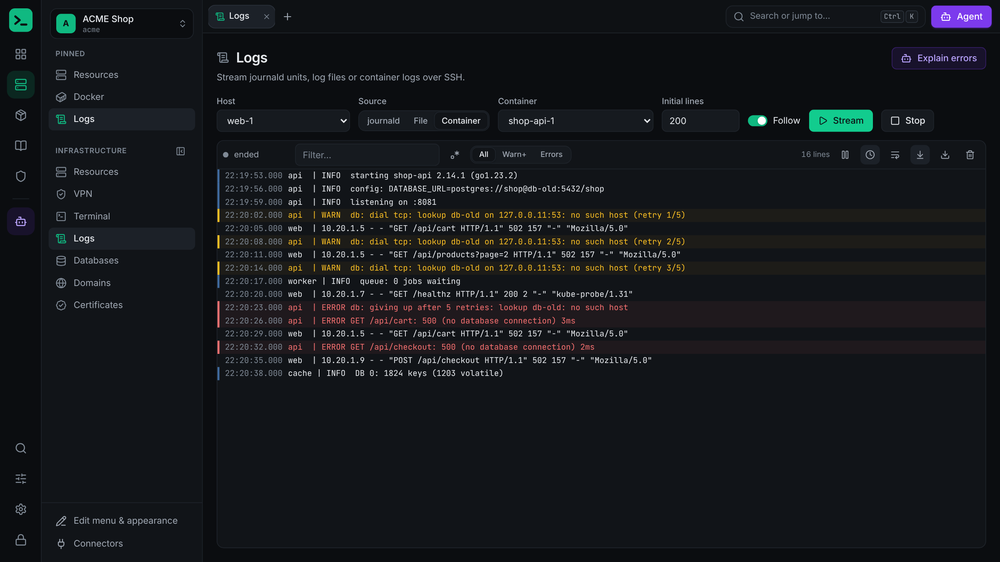<br><sub><b>Logs</b>: journald, files and containers, live, with level filters.</sub></td>
  </tr>
  <tr>
    <td>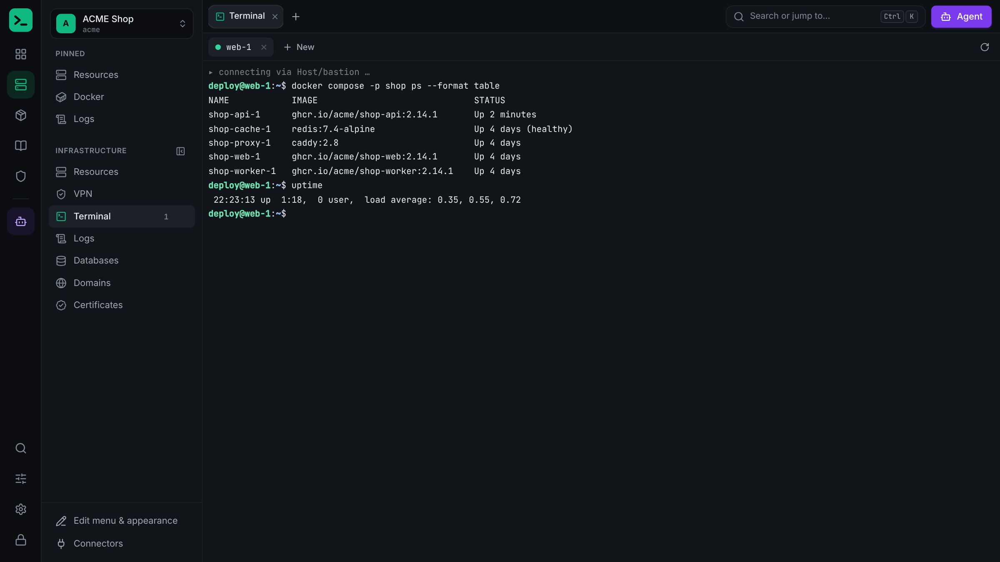<br><sub><b>Terminal</b>: SSH through jump hosts and VPNs, which opsdeck sets up for you.</sub></td>
    <td>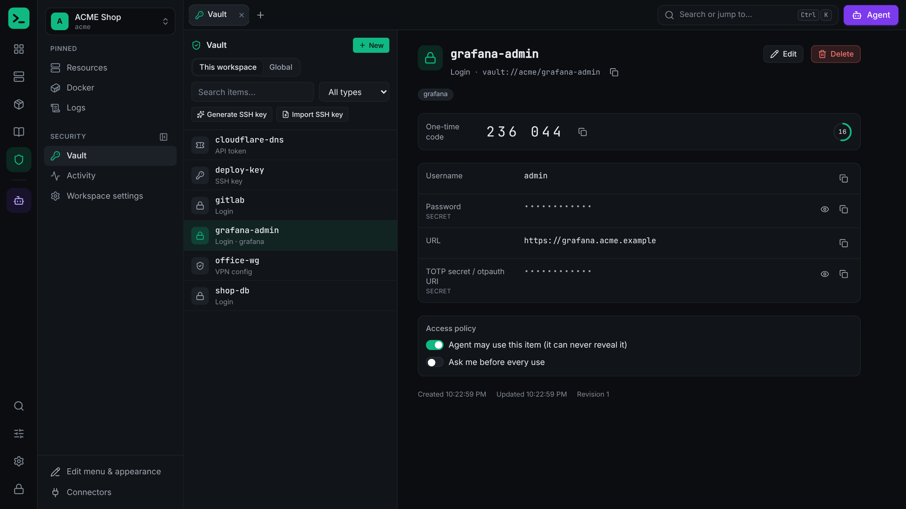<br><sub><b>Vault</b>: SSH keys, logins with TOTP and tokens, encrypted on your computer.</sub></td>
  </tr>
  <tr>
    <td>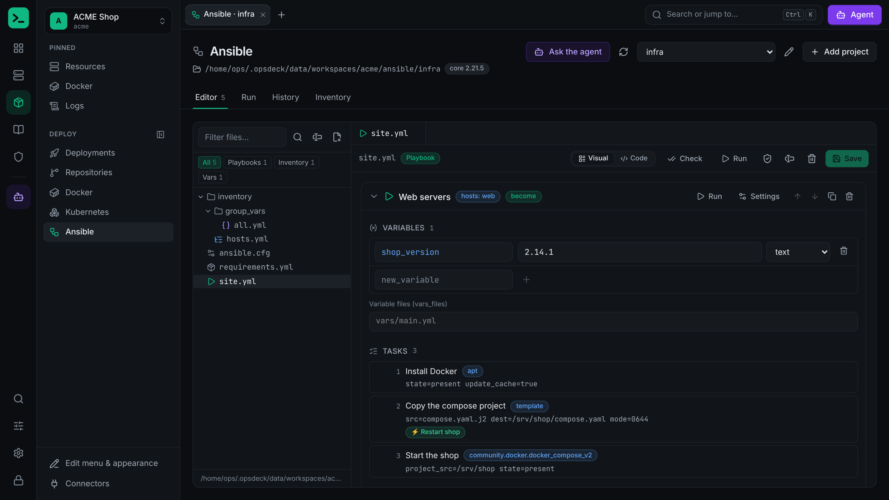<br><sub><b>Ansible</b>: playbooks, roles and inventories in a visual editor, runs with live logs.</sub></td>
    <td>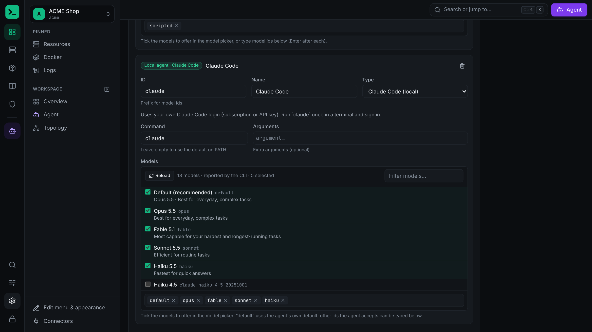<br><sub><b>Local agents</b>: use Claude Code, Codex, Gemini CLI or an ACP agent and pick its models from the list it reports.</sub></td>
  </tr>
  <tr>
    <td>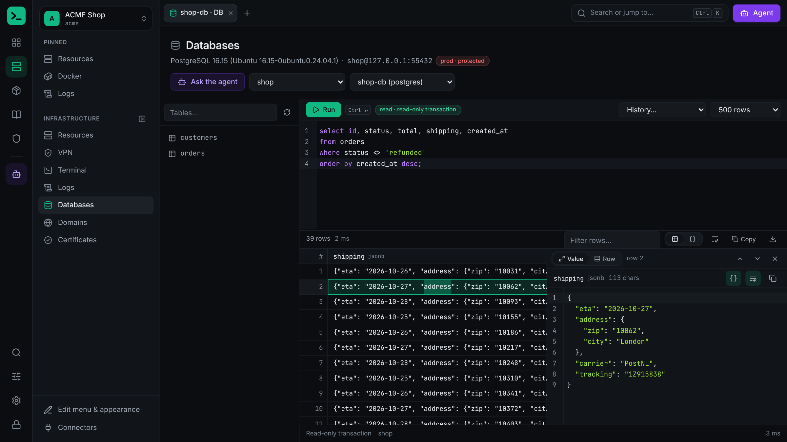<br><sub><b>Databases</b>: PostgreSQL, MySQL, MariaDB, MongoDB and Redis; the whole value of a cell, JSON indented, beside the results.</sub></td>
    <td>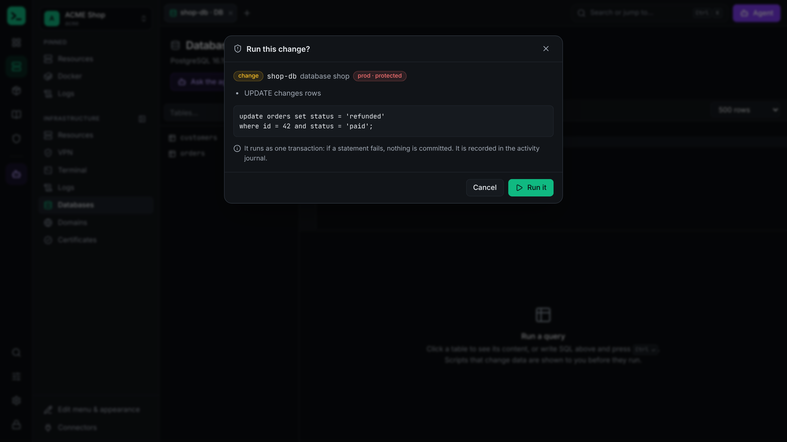<br><sub><b>Changes ask first</b>: an UPDATE on a protected database is shown with its risk and runs as one transaction.</sub></td>
  </tr>
  <tr>
    <td>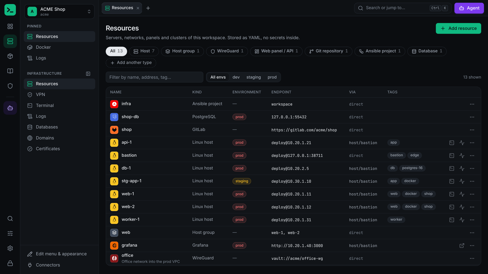<br><sub><b>Resources</b>: hosts, groups, VPNs, panels, databases and clusters as plain YAML.</sub></td>
    <td>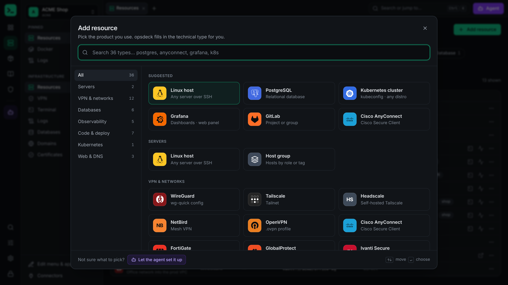<br><sub><b>Add resource</b>: pick the product you use, by its logo or by searching; opsdeck fills in the technical type.</sub></td>
  </tr>
  <tr>
    <td>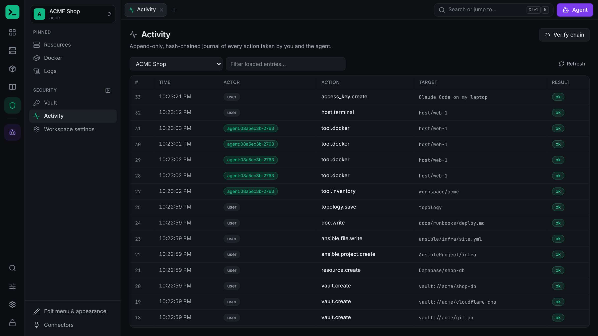<br><sub><b>Activity</b>: a hash-chained journal of every action, by you or the agent.</sub></td>
  </tr>
</table>

## Getting started

When you first open opsdeck, it asks you to create the vault (master password; there is
no recovery). Then:

1. **New workspace** → e.g. `acme`.
2. **Vault → Generate SSH key** (or import yours); copy the public key to your servers.
3. **Resources → Add resource** → hosts with address, port, user, credential, and `via`
   if they sit behind a bastion or VPN. Add a **WireGuard network** by storing the
   `.conf` as a *VPN config* vault item.
4. **App settings → Model providers** → add an API provider (key stored in the vault), or
   under **Local agents** pick an installed CLI (Claude Code, Codex, Gemini CLI…) that
   you have already signed in to.
5. **Agent** → ask: *"Check disk and memory on all prod hosts"*, or *"Clone shop from
   GitLab onto test-1 and run it as a single container"*.

Without any model configured everything except the Agent page works.

<p align="center">
  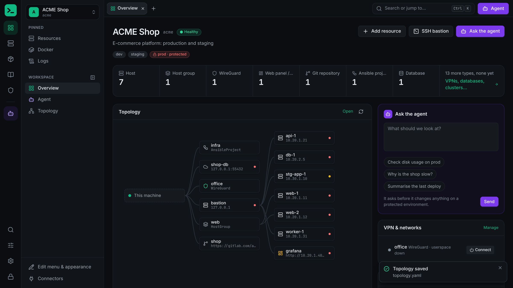
</p>

### Build from source

Requirements: Go 1.24+ (the toolchain auto-downloads 1.27) and Node 20+. For VPNs, these
are optional: openvpn, openconnect (+ ocproxy), openfortivpn, wireguard-tools.

```bash
make build          # builds the web UI and bin/opsdeck
bin/opsdeck         # starts on http://127.0.0.1:7788 and opens the browser
make desktop        # the desktop app (needs the Wails CLI), see docs/desktop.md
```

### Try it without servers

```bash
make demo
bin/opsdeck-demo -pubkey "<public key from a vault ssh-key>"
```

starts two local SSH servers (a bastion and an app host reachable only through it) and a
scripted model endpoint (OpenAI-compatible), and prints their addresses.

### Commands

```
opsdeck [serve] [--port 7788] [--no-open]   start the server and UI
opsdeck run -p "prompt" --ws <workspace>    run the agent headless (needs a running opsdeck)
opsdeck mcp                                 MCP server for other agents over stdio (OPSDECK_TOKEN=odk_…)
opsdeck skill install <agent>               install the opsdeck skill for claude-code, codex, gemini, cursor
opsdeck url                                 print the login link
opsdeck paths                               show where data is stored
```

The server only listens on `127.0.0.1`. The login link carries a token (stored in the
state directory); the browser keeps it as an HttpOnly cookie. Requests with a foreign
`Host` or `Origin` are refused.

## Data

| What | Where (Linux; macOS/Windows use their app-data folders) |
|---|---|
| Vault | `~/.local/share/opsdeck/vault.db` |
| Workspaces — inventory, docs, runbooks, agent reports, memory, sessions | `~/.local/share/opsdeck/workspaces/<name>/` (or any imported folder); see [docs/workspace.md](docs/workspace.md) |
| Audit journal | `~/.local/state/opsdeck/audit/` |
| Settings | `~/.config/opsdeck/config.yaml` |

`OPSDECK_HOME=/some/dir` puts everything under one directory.

## Development

```bash
make test                                      # Go tests + TypeScript typecheck
cd web && npm run dev                          # UI dev server on :5173
bin/opsdeck --dev-origin http://localhost:5173 # backend for the dev server
```

The Go test suite runs real SSH servers (exec, PTY, SFTP, jump hosts), userspace
WireGuard peers, a stdio MCP server and scripted models — no external infrastructure
needed. The Docker and Kubernetes integration tests also run against a local `dockerd` and
k3s cluster when one is present (`OPSDECK_TEST_KUBECONFIG`), the Databases tests against
PostgreSQL, MySQL/MariaDB, MongoDB and Redis servers (`OPSDECK_TEST_POSTGRES`,
`OPSDECK_TEST_MYSQL`, `OPSDECK_TEST_MONGO`, `OPSDECK_TEST_REDIS` =
`user:password@host:port/db`, as CI does), and the Ansible tests against an installed
`ansible-core`; they are skipped otherwise.

The browser tests in [`e2e/`](e2e) drive the built UI with Playwright against a real
opsdeck (`tools/e2e`: a fresh data folder, local SSH hosts, a scripted model): unlocking,
adding a resource, search, customizing, an agent change that waits for approval, and
connecting an outside agent.

```bash
cd web && npm run build && cd ../e2e
npm ci && npx playwright install chromium
npx playwright test
```

The README screenshots come from the demo workspace of `tools/e2e -demo` (see
`e2e/screenshots.config.ts`): `npx playwright test -c screenshots.config.ts` there
rewrites `docs/assets/screenshot-*.png`.

## Status and known limits

- OpenVPN, OpenConnect (AnyConnect/ocserv/FortiGate/…) and openfortivpn profiles need those
  programs installed (`ocproxy` for OpenConnect userspace mode); Tailscale, NetBird and
  WireGuard are built in. OpenVPN and openfortivpn only run in system mode.
- Git repositories need `git` installed (and `ssh` for SSH URLs). Repository hooks don't
  run in opsdeck's working copies.
- Docker is driven through the `docker` CLI on the host over SSH (with `sudo -n` when the
  SSH user is not in the `docker` group); Compose needs the `docker compose` plugin (v2).
- PuTTY `.ppk` keys must be converted to OpenSSH format first.
- Kubeconfigs that use `exec` auth plugins run those plugins on this machine.
- Ansible needs `ansible-core` (and `ssh`) on this computer; Windows needs WSL. Hosts of the
  generated workspace inventory must log in with an SSH key (password logins would need
  `sshpass`).
- MCP servers from a workspace only start after you save them in Workspace settings on
  this machine (protects you from commands in a cloned workspace).
- The agent's access to this computer (Settings → This computer) is on by default: it can
  read files with consent, and every local write or command asks. Turn it off there if you
  only want it to work on workspace hosts.
- The agent's web access (App settings → Web access) is on by default, except in workspaces
  that allow only local models. Search without a key uses DuckDuckGo's HTML page, which can
  rate-limit heavy use; SearXNG, Brave or Tavily are steadier.
- Tested mostly on Linux. The macOS and Windows desktop apps are built and released by CI,
  but have seen less use.

## Documents

- [docs/architecture.md](docs/architecture.md) — framework, modules, data layout
- [docs/desktop.md](docs/desktop.md) — the desktop app: how it works, install, build
- [docs/releasing.md](docs/releasing.md) — versions, releases and how updates install
- [docs/agents.md](docs/agents.md) — use opsdeck from Claude Code, Codex, Cursor, Gemini CLI: access keys, MCP setup, the skill pack
- [docs/compatibility.md](docs/compatibility.md) — what is stable between versions, file formats, deprecation
- [docs/schema.md](docs/schema.md) — every resource kind and its fields (generated)
- [docs/harness.md](docs/harness.md) — agent loop, tools, permissions, web access, subagents, hooks, background tasks, headless runs
- [docs/vault.md](docs/vault.md) — vault design
- [docs/workspace.md](docs/workspace.md) — workspace model and files
- [docs/vpn.md](docs/vpn.md) — VPN drivers, userspace vs system mode, credentials
- [docs/git.md](docs/git.md) — Git repositories, working copies, merge requests
- [docs/dns.md](docs/dns.md) — Domains: Cloudflare and ArvanCloud connectors, zones and records, the agent's dns tool
- [docs/deployments.md](docs/deployments.md) — Deployments: Portainer, Argo CD and Komodo per workspace, the Deployments page, the agent's deploy tool
- [docs/certificates.md](docs/certificates.md) — TLS certificates: ACME with dns-01, the vault, deployment, renewal, the agent's certificate tool
- [docs/topology.md](docs/topology.md) — the topology map and the agent's topology tool
- [docs/skills.md](docs/skills.md) — skills, the built-in library
- [docs/docker.md](docs/docker.md) — Docker: containers, compose, swarm, volumes, logs
- [docs/kubernetes.md](docs/kubernetes.md) — Kubernetes: resources, logs, exec, apply with diff, rollouts, Helm
- [docs/databases.md](docs/databases.md) — Databases: PostgreSQL, MySQL, MongoDB, Redis; reads and changes, the results grid, the agent's database tool
- [docs/scripts.md](docs/scripts.md) — scripts: your library and the workspace's, approval, running on hosts
- [docs/ansible.md](docs/ansible.md) — Ansible: projects, Ansible Vault, runs and logs, the agent's tools and password prompt
- [docs/api.md](docs/api.md) — local HTTP API used by the UI
- [docs/decisions.md](docs/decisions.md) — decisions and open questions

## Contributing

Bug reports, ideas and pull requests are welcome; see [CONTRIBUTING.md](CONTRIBUTING.md).
Please report security problems privately as described in [SECURITY.md](SECURITY.md).

## License

opsdeck is released under the [MIT License](LICENSE). The built-in skills from
[wshobson/agents](https://github.com/wshobson/agents) keep their own MIT license
(`internal/skills/library/LICENSE-wshobson-agents`).
